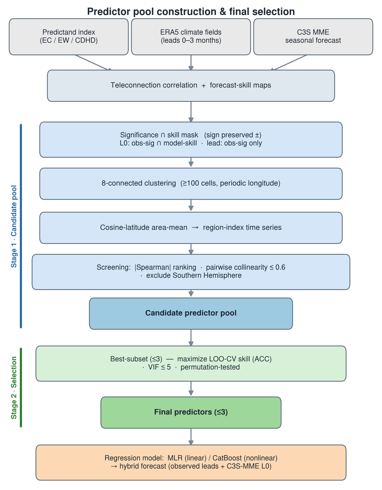

# Statistical–Dynamical Hybrid Model for Hard-to-Predict Climate Variables — Winter EC/EW (Linear)

A **statistical–dynamical hybrid** approach to **seasonal prediction of climate variables that dynamical models cannot forecast well directly** — air quality (e.g. PM10), atmospheric blocking, warm/cold extremes — by **bridging** such targets to the large-scale fields a **multi-model ensemble** *does* forecast skilfully. **This repository is the linear (MLR) core for Korean winter extremes (EC/EW).**

Statistical–dynamical (multiple linear regression, **MLR**) seasonal prediction of **Korean winter extreme-cold days (EC) and extreme-warm days (EW)** over the December–January–February (DJF) season.

This repository contains the research implementation of the **linear statistical–dynamical model** developed in the Korea Meteorological Administration (KMA) R&D project *“AI-based research on climate-extreme variability and prediction”* (Sejong University component). The model predicts the DJF count of extreme cold / warm days over the Korean Peninsula by combining **observed autumn precursors** with the **large-scale winter state forecast by a dynamical multi-model ensemble (C3S MME)**.

## Overview

Pure dynamical models have limited skill for regional seasonal extremes, while purely data-driven models struggle with the short observational record (~40–50 winters). This model takes a **statistical–dynamical (hybrid)** approach: a lean, interpretable linear regression that **borrows the skillfully-forecast large-scale predictors from the dynamical ensemble** and maps them to the regional extreme-day count.

- **Predictands:** DJF Korean extreme-cold-day count (**EC**) and extreme-warm-day count (**EW**), from an ERA5-based percentile index.
- **Predictors:** physically-motivated teleconnection indices, screened to those the dynamical ensemble forecasts skillfully.
- **Estimator:** multiple linear regression (this repo). The non-linear (CatBoost) counterpart is in a sibling repository.

## How the predictors are built



Predictors are built in **two stages** — an automated, physically-constrained *candidate-pool construction* (identical across all four model variants — summer/winter × linear/nonlinear) followed by a *final selection* that keeps only the few predictors maximising out-of-sample skill.

**Stage 1 — candidate pool.** The detrended predictand index is correlated against global ERA5 climate fields (T2m, MSL, SST, Z500, U200, V200, T850, Z850, precipitation, …) at lead times of 0–3 months, and the C3S multi-model-ensemble (MME) forecast skill is mapped for each field in parallel. A grid cell becomes a predictor source only where it is physically *and* operationally useful, through a **dual-condition significance mask**:

- **concurrent (L0)** fields must be **both** significantly correlated with the predictand (Spearman, *p* < 0.05) **and** skilfully forecast by the dynamical ensemble (skill significant, *r* > 0) — so the statistical link can actually be exploited at forecast time;
- **lead (L1–L3)** fields require only observational significance, since they are already observed when the forecast is issued.

The relationship sign (±) is preserved. The mask is segmented into coherent regions by **8-connected component labelling** (periodic in longitude), keeping only clusters of **≥ 100 grid cells**, and each region is reduced to one **cosine-latitude area-mean** index time series. Candidates are ranked by |Spearman| with the predictand, then filtered by a **greedy pairwise-collinearity rule** (drop any with |Spearman| > 0.6 against an already-accepted index) and a **Southern-Hemisphere exclusion** — yielding the *candidate predictor pool* (≈ 70–80 regions per predictand).

**Stage 2 — final selection.** From the pool, **all subsets of up to three predictors** are scored by **leave-one-out cross-validated skill (anomaly correlation, ACC)** with a closed-form LOOCV (PRESS); multicollinearity is bounded by **VIF ≤ 5**, and the selected model's skill is tested against chance by a **permutation test**. Keeping the predictor count small (≤ 3) avoids overfitting the short (~45-season) record. The final predictors feed the regression model (**MLR** in the linear repositories, **CatBoost** in the nonlinear ones) — concurrent (L0) terms supplied operationally by the distribution-calibrated C3S-MME forecast, lead terms by observations.

## Method (pipeline)

| step | script | description |
|---|---|---|
| 1 | `src/00_corr_leads.py` | Detrended correlation of the EC/EW index against global climate fields at leads 0–3 months (teleconnection diagnosis). |
| 2 | `src/01_make_predictor_index.py` | Predictor-pool construction: (observation significance) ∩ (dynamical-ensemble forecast skill) mask → **8-connected clustering (≥100 grid cells, periodic in longitude)** → cosine-latitude area-mean index → greedy collinearity screening (pairwise \|Spearman\| ≤ 0.6) + Southern-Hemisphere exclusion. |
| 3 | `src/02_select_mlr.py` | Final predictor selection: **best-subset (≤3 predictors)** maximizing **leave-one-out cross-validated skill (ACC)**, with VIF ≤ 5 multicollinearity control. |
| 4 | `src/03_forecast_hybrid.py` | Hybrid forecast: concurrent (L0) predictors supplied by the **C3S-MME forecast** (distribution-calibrated to observations), lead predictors supplied by observations, mapped through the fitted MLR. |

## Selected predictors (final models)

Final MLR predictors per predictand. Coefficients (**β**) are standardised (z-scored, detrended predictors; fit over 1979–2024). L0 = concurrent-winter field (supplied by the dynamical ensemble at forecast time); L1–L3 = observed autumn precursors (L1 = Nov, L2 = Oct, L3 = Sep).

**EC — extreme-cold days**

| predictor | lead | variable | region | β (std.) |
|---|---|---|---|---|
| α | L0 (DJF) | 2-m temperature | Siberia (≈50°N, 105°E) | −2.02 |
| β | L3 (Sep) | precipitation | central North Pacific (≈44°N, 174°W) | +1.73 |
| γ | L2 (Oct) | precipitation | western Russia / Ural (≈48°N, 60°E) | +1.39 |

**EW — extreme-warm days**

| predictor | lead | variable | region | β (std.) |
|---|---|---|---|---|
| α | L0 (DJF) | 2-m temperature | subtropical NW Pacific (≈28°N, 137°E) | +1.22 |
| β | L1 (Nov) | 850-hPa temperature | N. Australia / Maritime Continent (≈14°S, 135°E) | +1.22 |
| γ | L0 (DJF) | 850-hPa temperature | Gulf of Alaska / Bering (≈58°N, 150°W) | −1.14 |

## Repository structure

```
.
├── src/
│   ├── 00_corr_leads.py           # teleconnection correlation maps (predictand vs fields, leads 0–3)
│   ├── 01_make_predictor_index.py # predictor-pool construction (mask → cluster → index → screen)
│   ├── 02_select_mlr.py           # best-subset MLR selection (LOOCV + VIF)
│   └── 03_forecast_hybrid.py      # hybrid forecast (observed leads + C3S-MME L0)
├── data/                          # input data (not included — see data/README.md)
├── requirements.txt
└── README.md
```

## Data

Raw datasets are **not included** (size / licensing). Place inputs under `./data/` (or set the path at the top of each script). Required inputs and sources:

- **ERA5** monthly atmospheric fields — Copernicus Climate Data Store (CDS).
- **C3S seasonal multi-model** hindcast/forecast (L0 dynamical predictors) — CDS.
- **EC/EW index** `ERA5_DJF_{EC,EW}_index_1979-2024.nc` (ERA5-based percentile count over Korea).

See `data/README.md` for the expected file list and format.

## Usage

```bash
pip install -r requirements.txt
# place inputs under ./data  (see data/README.md)
python src/00_corr_leads.py          # teleconnection correlations
python src/01_make_predictor_index.py # build predictor pool
python src/02_select_mlr.py EC_day    # final MLR selection (EC_day | EW_day)
python src/03_forecast_hybrid.py      # hybrid skill / forecast
```

## References

This work applies the **statistical–dynamical (dynamical–statistical) seasonal-forecasting framework** of:

- Choi, J. *et al.* (2024). Dynamical–statistical method for seasonal forecasting of wintertime PM10 concentration in South Korea using multi-model ensemble climate forecasts. *Environmental Research Letters*, **19**, 064073. https://doi.org/10.1088/1748-9326/ad5030
- Jeong, J.-H., Choi, J., Jeong, J.-Y., Woo, S.-H., Kim, S.-W., Lee, D., Lee, J.-B., & Yoon, J.-H. (2022). A novel statistical–dynamical method for a seasonal forecast of particulate matter in South Korea. *Science of the Total Environment*, **848**, 157699. https://doi.org/10.1016/j.scitotenv.2022.157699

## Authors

Jee-Hoon Jeong (정지훈)¹, Gyu-Ri Lee (이규리)¹
¹ Sejong University, Republic of Korea

## Funding

This research was supported by the **Korea Meteorological Administration Research and Development Program** under Grant **RS-2025-02307979**.

## Citation

If you use this code, please cite the associated project report / manuscript (Jeong, Lee et al., 2026) and acknowledge the funding grant above.

## Legal Notice

This repository contains original research code developed for academic and scientific purposes.

Any use, reproduction, modification, distribution, or derivative work based on this code is strictly prohibited without prior written permission from the authors.

If this code is used in any form of academic, research, or commercial work, proper citation and explicit acknowledgment of all original authors and affiliated institutions is mandatory.

Unauthorized use or redistribution without permission may result in legal consequences.
